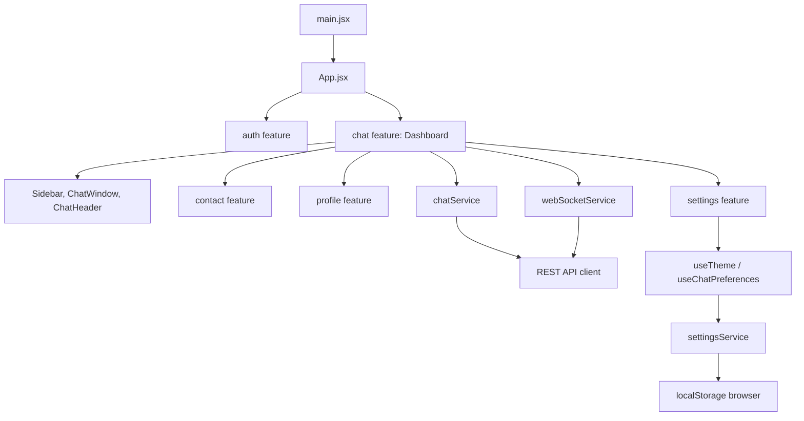

# Lechat

Frontend aplikasi chatting Lechat dibuat dengan React dan Vite. Login, registrasi, percakapan, kontak, riwayat/pengiriman pesan, dan koneksi real-time terhubung ke REST API serta WebSocket backend. Panggilan, unggah media, dan sebagian profil/pengaturan masih berupa UI demo.

## Menjalankan proyek

Pastikan Node.js dan npm sudah tersedia, lalu jalankan dari direktori proyek:

```bash
npm install
npm run dev
```

Buka alamat lokal yang ditampilkan oleh Vite di terminal. Perintah lain yang tersedia:

```bash
npm run lint
npm run build
npm run preview
```

## Koneksi backend

Salin `.env.example` menjadi `.env.local`, lalu sesuaikan URL API dan WebSocket dengan backend:

```env
VITE_API_BASE_URL=http://localhost:8989/api/v1
VITE_WS_URL=ws://localhost:8989/api/v1/ws
```

`VITE_API_BASE_URL` juga menerima origin backend tanpa `/api/v1`. Jika `VITE_WS_URL` kosong, alamat WebSocket diturunkan dari URL API. Gunakan HTTPS/WSS di production. Backend harus mengizinkan origin frontend melalui CORS dan pemeriksaan origin WebSocket.

Token access dan refresh disimpan dalam cookie yang ditulis JavaScript (`SameSite=Lax`, `Secure` saat HTTPS), sehingga bukan cookie `HttpOnly`. Client melakukan refresh terkoordinasi setelah respons `401`, retry request satu kali, dan mengganti kedua token. Jangan mencatat token ke log. Detail endpoint dan urutan frame tersedia di [REACT_INTEGRATION.md](./REACT_INTEGRATION.md).

REST memuat percakapan, kontak, dan riwayat; pengiriman teks memakai WebSocket setelah autentikasi serta join berhasil. Reconnect menggunakan backoff, autentikasi ulang, join ulang, dan sinkronisasi riwayat. Lampiran belum didukung backend; arsip percakapan saat ini hanya disimpan lokal karena endpoint arsip tidak tercantum dalam kontrak API.

## Alur penggunaan UI

1. **Masuk** — masukkan email dan kata sandi akun, lalu tekan **Masuk ke Lechat**. Form mengirim `POST /api/v1/sessions`; token dan refresh token disimpan setelah login. Saat aplikasi dimuat kembali, sesi diperiksa melalui `GET /api/v1/sessions/check-session`; respons `401` memicu satu refresh terkoordinasi dan retry.
2. **Kredensial tidak cocok** — pesan error dari server ditampilkan dan aplikasi tetap berada di halaman login.
3. **Berpindah ke registrasi** — pilih **Daftar sekarang** pada halaman login untuk membuka form pendaftaran.
4. **Mendaftar** — isi nama, email, kata sandi minimal 8 karakter, konfirmasi kata sandi yang sama, dan centang persetujuan pendaftaran. Form memvalidasi dan merapikan nama/email, lalu mengirim `{ name, email, password, password_confirmation }` ke `POST /api/v1/registers`. Jika server berhasil, dashboard dibuka; pesan validasi atau kegagalan server ditampilkan pada form.
5. **Kembali ke login** — pilih **Masuk** pada halaman registrasi.
6. **Mengelola kata sandi di form login** — opsi **Ingat saya** dapat dipilih dan tombol ikon mata menampilkan atau menyembunyikan kata sandi. Tautan lupa kata sandi menampilkan informasi bahwa pemulihan akun belum tersedia.
7. **Keluar** — buka profil pribadi dari navigasi, lalu pilih **Log out**. Backend mencabut access token dan frontend menghapus token lokal.
8. **Melihat percakapan** — daftar percakapan dimuat dari backend bersama cuplikan pesan terakhir, waktu, dan jumlah pesan belum dibaca.
9. **Mencari percakapan** — ketik nama kontak atau cuplikan pesan pada kolom pencarian. Daftar akan disaring langsung.
10. **Melihat kontak** — pilih ikon Kontak di navigasi desktop atau tab **Kontak** pada daftar mobile. Kontak accepted dimuat dari backend; badge pada navigasi menunjukkan jumlah permintaan yang menunggu persetujuan penerima.
11. **Membuka chat dari kontak** — pilih kontak untuk membuat atau membuka direct conversation.
12. **Memfilter pesan** — pilih **Semua** atau **Belum dibaca**. Angka pada filter belum dibaca mengikuti jumlah percakapan yang masih memiliki pesan belum dibaca.
13. **Membuka percakapan** — pilih item pada daftar. Riwayat dimuat dan receipt read/delivered dikirim sesuai cursor pesan terakhir.
14. **Mengirim pesan** — ketik pesan teks di bagian bawah area chat lalu tekan **Enter** atau tombol kirim. Pesan dikirim melalui WebSocket dengan ID idempotensi agar retry tidak membuat duplikasi.
14. **Melihat detail** — pada layar lebar, panel kanan menampilkan status kontak, tombol telepon/video, media bersama, file contoh, dan catatan privasi.
15. **Menggunakan layar kecil** — panel daftar percakapan disembunyikan saat chat aktif. Tombol kembali di header membuka daftar, dengan tab untuk berpindah antara pesan, kontak, dan arsip.
16. **Membuat percakapan** — tombol plus membuka form untuk membuat direct chat menggunakan ID pengguna atau grup menggunakan daftar ID anggota.
17. **Mengarsipkan percakapan** — menu opsi pada header memindahkan chat ke Arsip lokal. Endpoint arsip backend belum tersedia.
18. **Mengirim emoji** — emoji dapat dimasukkan ke pesan teks. Lampiran belum bisa dikirim karena backend belum menyediakan upload media.
19. **Mengatur preferensi chat** — mode gelap, preferensi notifikasi, dan indikator pesan tersimpan di browser. Pengaturan indikator pesan memengaruhi centang pada pesan keluar.
20. **Melihat media bersama** — galeri menampilkan contoh media. Aksi panggilan dan file contoh memberi pemberitahuan bahwa layanan backend belum tersedia.

## Alur pengerjaan dan struktur kode

### 1. Titik masuk aplikasi

`src/main.jsx` memasang stylesheet global dan merender `App` ke elemen `#root`.

### 2. Data, service, dan state UI

`src/App.jsx` menentukan apakah UI login, registrasi, atau dashboard yang ditampilkan dengan mengimpor halaman fitur melalui barrel `src/features/auth/index.js` dan `src/features/chat/index.js`. Status masuk diverifikasi melalui API sesi dan token. `src/features/chat/components/Dashboard.jsx` mengambil data melalui `chatService`, mengelola state tampilan, lalu meneruskan aksi pengguna ke service:

- `authStatus` di `src/App.jsx` mengendalikan perpindahan dari form login ke dashboard.
- `chats` menyimpan hasil pemuatan percakapan, cuplikan, jumlah pesan belum dibaca, arsip, serta isi pesan untuk tampilan saat ini.
- `activeId` menentukan percakapan yang sedang dibuka.
- `search` dan `filter` mengendalikan penyaringan daftar.
- `message` menyimpan isi composer sebelum dikirim.
- `showConversations` mengendalikan tampilan daftar pada perangkat kecil.

Daftar yang ditampilkan diturunkan dari data yang dimuat melalui `useMemo`. Status memuat dan kegagalan pemuatan ditampilkan di sidebar, dengan aksi coba lagi bila service gagal.

### 3. Komponen dashboard chat

`src/features/chat/components/Dashboard.jsx` mengatur state tampilan dashboard dan menghubungkan interaksi ke service. Fitur dibagi menurut tanggung jawab:

- `src/features/chat/components/ChatSidebar.jsx` menampilkan navigasi, pencarian, filter, daftar percakapan, kontak, dan arsip. Aksi buat chat, buka chat, serta pulihkan arsip menggunakan service chat.
- `src/features/contact/components/ContactsList.jsx` menampilkan kontak accepted, permintaan kontak, undangan grup, dan form permintaan baru berdasarkan nomor telepon. Permintaan dikirim dengan pencocokan nomor persis; penerimaan/penolakan memakai ID pengguna. Fitur ini diekspor melalui `src/features/contact/index.js`.
- `src/features/contact/components/ContactsList.css` menampung styling daftar kontak dan dukungan tema gelap agar tampilan kontak terisolasi dari stylesheet dashboard.
- `src/features/chat/components/ChatWindow.jsx` menampilkan header, pesan, indikator mengetik, serta composer untuk pesan teks, lampiran lokal, dan emoji.
- `src/features/chat/components/ChatHeader.jsx` menampilkan identitas kontak, panel detail, aksi arsip, serta pemberitahuan untuk panggilan yang belum terhubung.
- `src/features/contact/components/ContactDetails.jsx` menampilkan profil, media, dan file bersama. Panel ini dibuka dari profil di header chat dan tetap berada di sisi kanan; pada layar sempit panel tampil sebagai drawer dari sisi kanan.
- `src/features/profile/components/PersonalProfile.jsx` menampilkan profil pribadi ketika avatar `AR` di navigasi atau header mobile dipilih. Feature ini memiliki barrel `src/features/profile/index.js`; informasi profil masih berupa data contoh.
- `src/features/settings/components/SettingsPanel.jsx` menampilkan preferensi tampilan di feature tersendiri. `src/features/settings/hooks/useTheme.js` dan `useChatPreferences.js` mengelola preferensi UI.
- `src/features/chat/services/chatService.js` memuat percakapan, kontak, permintaan/undangan, dan history REST; membuat conversation, mengelola permintaan kontak/grup, dan menandai read. Pengiriman teks dilakukan oleh `src/features/chat/services/webSocketService.js` menggunakan protokol WebSocket backend.
- `src/features/settings/services/settingsService.js` mengekspor `getThemePreference()`, `saveThemePreference(theme)`, `getChatPreferences()`, dan `saveChatPreferences(preferences)` untuk menyimpan tema, preferensi notifikasi, dan indikator pesan ke `localStorage`. API publik feature settings tersedia lewat `src/features/settings/index.js`.
- `src/features/profile/index.js` mengekspor komponen profil pribadi; `src/features/chat/index.js` mengekspor dashboard dan service chat.
- Pada mobile, akses profil pribadi dan Settings tersedia dari header daftar chat, bukan dari header ketika percakapan sedang terbuka.
- `src/features/chat/components/ChatAvatar.jsx` dan `src/features/chat/components/ChatIcon.jsx` menyediakan elemen visual yang digunakan ulang di fitur chat.
- `src/features/chat/chatData.js` menyimpan data contoh awal secara terpisah dari tampilan dan state.
- Data percakapan, kontak, dan pesan aktif berasal dari backend; tema dan preferensi UI tersimpan di `localStorage`. Arsip juga masih lokal karena API belum menyediakan endpoint arsip. Panggilan, unggah file, dan notifikasi push memerlukan layanan backend tambahan.
- `src/features/contact/` memisahkan UI daftar kontak dari dashboard chat. Sidebar mengakses komponen kontak melalui barrel feature.
- `src/components/` disiapkan untuk komponen UI generik yang digunakan bersama oleh beberapa fitur.

Barrel `index.js` mengekspor API publik utama tiap fitur agar pemanggil tidak perlu mengimpor melalui jalur internal `components/`. Impor antar-komponen internal tetap menggunakan file langsung agar dependensi fitur jelas.

### 4. Arsitektur aplikasi

Lechat menggunakan **feature-based frontend architecture**. Kode dikelompokkan berdasarkan domain UI, sedangkan setiap feature memisahkan komponen, hooks, service, dan utilitas sesuai kebutuhannya:

```text
src/
├── App.jsx                    # Pemilihan halaman autentikasi atau dashboard
├── main.jsx                   # Bootstrap React dan stylesheet global
├── components/                # Area untuk komponen UI generik lintas feature
└── features/
    ├── auth/                  # Login, registrasi, pengelolaan sesi
    │   ├── components/
    │   ├── hooks/
    │   ├── services/
    │   └── utils/
    ├── chat/                  # Dashboard, navigasi, daftar dan jendela chat
    │   ├── components/
    │   ├── services/          # REST chat service dan WebSocket
    │   └── chatData.js        # Data contoh lama, tidak dipakai oleh API chat
    ├── contact/               # Daftar kontak dan detail kontak
    │   └── components/
    ├── profile/               # Profil pribadi
    │   └── components/
    └── settings/              # Panel, hooks, dan service preferensi
        ├── components/
        ├── hooks/
        └── services/
```

Alur dependensi utama:



**Tanggung jawab dan aturan dependensi:**

1. `App.jsx` menjadi composition root: memilih halaman auth atau dashboard dan meneruskan callback autentikasi.
2. Komponen UI merender state dan menyampaikan aksi lewat props. `Dashboard` menjadi pemilik state layar chat serta koordinator pemanggilan service; komponen tidak mengakses `chatData` secara langsung.
3. Service menyediakan batas akses data yang asinkron. `chatService` mengakses REST API dan `webSocketService` mengelola koneksi native WebSocket; `settingsService` membaca/menyimpan preferensi ke `localStorage`.
4. Barrel `index.js` adalah API publik sebuah feature. Gunakan barrel untuk impor lintas feature; impor komponen internal langsung hanya di dalam feature yang sama. Komponen yang benar-benar dipakai lintas feature dapat dipindahkan ke `src/components/` agar arah dependensi antar-feature tetap sederhana.
5. Token disimpan pada cookie JavaScript (bukan `HttpOnly`) dan refresh dikoordinasikan pada client. Endpoint yang belum tercantum di kontrak—misalnya arsip, panggilan, upload media, dan notifikasi push—belum diintegrasikan.

**Alur data chat:** `Dashboard` meminta daftar ke `chatService` → hasilnya disimpan sebagai state UI → daftar diturunkan melalui pencarian/filter → aksi pilih/kirim/arsip memanggil service → service mengembalikan data percakapan yang diperbarui → dashboard memperbarui state untuk dirender kembali.

### 5. Komponen login

`src/features/auth/components/AuthLayout.jsx` menyediakan layout bersama untuk layar autentikasi. `src/features/auth/components/LoginPage.jsx` merender form login, kontrol tampil/sembunyikan kata sandi, dan opsi ingat saya; login menggunakan service `loginUser()` untuk mengirim kredensial ke endpoint backend. `src/features/auth/components/RegisterPage.jsx` merender form pendaftaran dengan validasi input wajib, panjang kata sandi, kesesuaian konfirmasi, dan persetujuan. Pendaftaran menggunakan service `registerUser()` untuk mengirim data ke endpoint backend.

Logika autentikasi dipisahkan lagi ke dalam folder peran:

- `src/features/auth/hooks/usePasswordVisibility.js` membagikan perilaku tampil/sembunyikan kata sandi di form login dan registrasi.
- `src/features/auth/services/authService.js` menyediakan request login ke `POST /api/v1/sessions`, fungsi refresh token ke `POST /api/v1/sessions/refresh` yang menggunakan refresh token, logout melalui `DELETE /api/v1/sessions`, serta registrasi ke `POST /api/v1/registers`; access dan refresh token disimpan terpisah sebagai cookie melalui `authTokenService.js`.
- `src/features/auth/utils/registrationValidation.js` memvalidasi input registrasi dan menormalisasi data sebelum dikirim ke service.
- `src/features/auth/utils/passwordValidation.js` memuat helper validasi kata sandi sederhana.

### 6. Styling dan responsivitas

- `src/index.css` menetapkan reset ringan, tipografi, warna dasar, dan fokus keyboard.
- `src/App.css` berisi layout chat tiga panel, komponen visual, animasi indikator mengetik, serta breakpoint untuk tablet dan ponsel; stylesheet ini dimuat oleh komponen `Dashboard`.
- `src/features/auth/AuthLayout.css` mengatur layout autentikasi bersama dan penyesuaian form untuk tablet dan ponsel.
- `index.html` menetapkan bahasa dokumen, judul tab, dan warna tema browser.

### 7. Validasi perubahan

Jalankan `npm run lint` untuk pemeriksaan ESLint dan `npm run build` untuk memastikan aplikasi dapat dibangun oleh Vite.

## Batasan template saat ini

- Percakapan, kontak, dan pesan menggunakan backend. Arsip disimpan lokal karena endpoint backend belum tersedia.
- Form login dan registrasi menggunakan endpoint backend dan konfigurasi `VITE_API_BASE_URL`. Pemulihan kata sandi belum tersedia.
- Emoji dikirim sebagai bagian dari pesan teks. Lampiran tidak diunggah atau disinkronkan. Media dan file di detail kontak masih berupa contoh.
- Panggilan suara/video dan notifikasi push belum terhubung ke layanan eksternal.
- Profil pengguna belum dimuat dari backend dan status presence mengikuti data percakapan yang tersedia.
