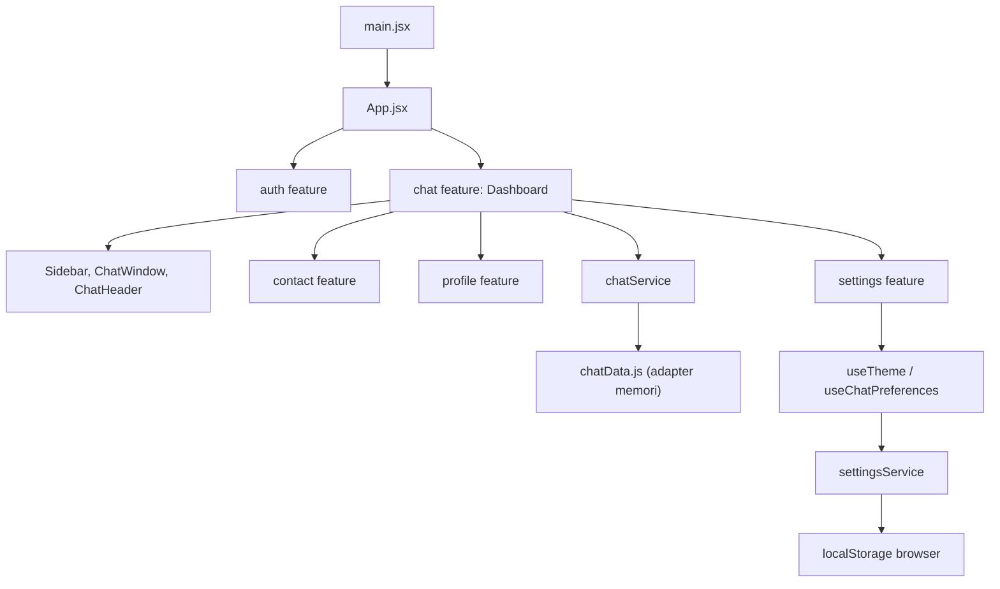

# Lechat

Template antarmuka aplikasi chatting yang dibuat dengan React dan Vite. UI mencakup autentikasi demo, navigasi, daftar percakapan dan kontak, area pesan, composer, arsip, profil, serta pengaturan. Fitur chat menggunakan service async dengan adapter data demo lokal; aplikasi belum terhubung ke API atau layanan real-time.

## Menjalankan proyek

Pastikan Node.js dan npm sudah tersedia, lalu jalankan dari direktori proyek:

```bash
npm install
npm run dev
```

Buka alamat lokal yang ditampilkan oleh Vite di terminal. Perintah lain yang tersedia:

```bash
npm run lint
npm run build
npm run preview
```

## Alur penggunaan UI

1. **Masuk** — gunakan akun demo `demo@lechat.app` dengan kata sandi `lechat123`, lalu tekan **Masuk ke Lechat**. Tombol **Gunakan** mengisi kedua kolom secara otomatis. Hanya pasangan tersebut yang membuka dashboard; kredensial diperiksa di sisi browser dan tidak dikirim ke server.
2. **Kredensial tidak cocok** — form menampilkan pesan kesalahan dan tetap berada di halaman login.
3. **Berpindah ke registrasi** — pilih **Daftar sekarang** pada halaman login untuk membuka form pendaftaran.
4. **Mendaftar (demo)** — isi nama, email, kata sandi minimal 8 karakter, konfirmasi kata sandi yang sama, dan centang persetujuan demo. Form memvalidasi dan merapikan nama/email, lalu meneruskan `{ name, email, password }` melalui callback registrasi. Saat ini callback hanya membuka dashboard; belum ada permintaan endpoint maupun penyimpanan akun.
5. **Kembali ke login** — pilih **Masuk** pada halaman registrasi.
6. **Mengelola kata sandi di form login** — opsi **Ingat saya** dapat dipilih dan tombol ikon mata menampilkan atau menyembunyikan kata sandi. Tautan lupa kata sandi menampilkan informasi bahwa pemulihan akun belum tersedia.
7. **Melihat percakapan** — daftar percakapan ditampilkan di panel kiri bersama avatar, cuplikan pesan terakhir, waktu, dan indikator pesan belum dibaca.
8. **Mencari percakapan** — ketik nama kontak atau cuplikan pesan pada kolom pencarian. Daftar akan disaring langsung.
9. **Melihat kontak** — pilih ikon Kontak di navigasi desktop atau tab **Kontak** pada daftar mobile. Daftar menampilkan kontak personal, status online, dan pencarian.
10. **Membuka chat dari kontak** — pilih kontak untuk membuka percakapan yang terkait.
11. **Memfilter pesan** — pilih **Semua** atau **Belum dibaca**. Angka pada filter belum dibaca mengikuti jumlah percakapan yang masih memiliki pesan belum dibaca.
12. **Membuka percakapan** — pilih item pada daftar. Percakapan tersebut menjadi aktif dan penghitung belum dibacanya direset.
13. **Mengirim pesan** — ketik pesan di bagian bawah area chat lalu tekan **Enter** atau tombol kirim. Pesan muncul di percakapan aktif dan cuplikan percakapan ikut diperbarui.
14. **Melihat detail** — pada layar lebar, panel kanan menampilkan status kontak, tombol telepon/video, media bersama, file contoh, dan catatan privasi.
15. **Menggunakan layar kecil** — panel daftar percakapan disembunyikan saat chat aktif. Tombol kembali di header membuka daftar, dengan tab untuk berpindah antara pesan, kontak, dan arsip.
16. **Membuat percakapan** — tombol plus membuka form lokal untuk membuat chat kontak atau grup. Percakapan bernama sama dibuka kembali agar tidak membuat duplikat.
17. **Mengarsipkan percakapan** — menu opsi pada header memindahkan chat ke Arsip. Percakapan bisa dikembalikan dari tab Arsip.
18. **Mengirim lampiran dan emoji** — pilih satu atau beberapa file dari perangkat atau masukkan emoji; lampiran hanya disimpan sementara di state browser dan tidak diunggah.
19. **Mengatur preferensi chat** — mode gelap, preferensi notifikasi, dan indikator pesan tersimpan di browser. Pengaturan indikator pesan memengaruhi centang pada pesan keluar.
20. **Melihat media bersama** — galeri menampilkan contoh media. Aksi panggilan dan file contoh memberi pemberitahuan bahwa layanan backend belum tersedia.

## Alur pengerjaan dan struktur kode

### 1. Titik masuk aplikasi

`src/main.jsx` memasang stylesheet global dan merender `App` ke elemen `#root`.

### 2. Data, service, dan state UI

`src/App.jsx` menentukan apakah UI login, registrasi, atau dashboard yang ditampilkan dengan mengimpor halaman fitur melalui barrel `src/features/auth/index.js` dan `src/features/chat/index.js`. Status masuk hanya state sementara untuk demo, bukan autentikasi. `src/features/chat/components/Dashboard.jsx` mengambil data melalui `chatService`, mengelola state tampilan, lalu meneruskan aksi pengguna ke service:

- `isLoggedIn` di `src/App.jsx` mengendalikan perpindahan dari form login ke dashboard.
- `chats` menyimpan hasil pemuatan percakapan, cuplikan, jumlah pesan belum dibaca, arsip, serta isi pesan untuk tampilan saat ini.
- `activeId` menentukan percakapan yang sedang dibuka.
- `search` dan `filter` mengendalikan penyaringan daftar.
- `message` menyimpan isi composer sebelum dikirim.
- `showConversations` mengendalikan tampilan daftar pada perangkat kecil.

Daftar yang ditampilkan diturunkan dari data yang dimuat melalui `useMemo`. Status memuat dan kegagalan pemuatan ditampilkan di sidebar, dengan aksi coba lagi bila service gagal.

### 3. Komponen dashboard chat

`src/features/chat/components/Dashboard.jsx` mengatur state tampilan dashboard dan menghubungkan interaksi ke service. Fitur dibagi menurut tanggung jawab:

- `src/features/chat/components/ChatSidebar.jsx` menampilkan navigasi, pencarian, filter, daftar percakapan, kontak, dan arsip. Aksi buat chat, buka chat, serta pulihkan arsip menggunakan service chat.
- `src/features/contact/components/ContactsList.jsx` menampilkan kontak personal, status online, dan pencarian kontak; memilih kontak membuka chat terkait. Fitur ini diekspor melalui `src/features/contact/index.js`.
- `src/features/contact/components/ContactsList.css` menampung styling daftar kontak dan dukungan tema gelap agar tampilan kontak terisolasi dari stylesheet dashboard.
- `src/features/chat/components/ChatWindow.jsx` menampilkan header, pesan, indikator mengetik, serta composer untuk pesan teks, lampiran lokal, dan emoji.
- `src/features/chat/components/ChatHeader.jsx` menampilkan identitas kontak, panel detail, aksi arsip, serta pemberitahuan untuk panggilan yang belum terhubung.
- `src/features/contact/components/ContactDetails.jsx` menampilkan profil, media, dan file bersama. Panel ini dibuka dari profil di header chat dan tetap berada di sisi kanan; pada layar sempit panel tampil sebagai drawer dari sisi kanan.
- `src/features/profile/components/PersonalProfile.jsx` menampilkan profil pribadi ketika avatar `AR` di navigasi atau header mobile dipilih. Feature ini memiliki barrel `src/features/profile/index.js`; informasi profil masih berupa data contoh.
- `src/features/settings/components/SettingsPanel.jsx` menampilkan preferensi tampilan di feature tersendiri. `src/features/settings/hooks/useTheme.js` dan `useChatPreferences.js` mengelola preferensi UI.
- `src/features/chat/services/chatService.js` menyediakan kontrak async `listConversations()`, `createConversation({ name, type })`, `markConversationRead(id)`, `sendMessage(id, { text, attachments })`, `archiveConversation(id)`, dan `restoreConversation(id)`. Service mengembalikan data percakapan; kegagalan seperti ID yang tidak ditemukan ditolak dengan error.
- `src/features/settings/services/settingsService.js` mengekspor `getThemePreference()`, `saveThemePreference(theme)`, `getChatPreferences()`, dan `saveChatPreferences(preferences)` untuk menyimpan tema, preferensi notifikasi, dan indikator pesan ke `localStorage`. API publik feature settings tersedia lewat `src/features/settings/index.js`.
- `src/features/profile/index.js` mengekspor komponen profil pribadi; `src/features/chat/index.js` mengekspor dashboard dan service chat.
- Pada mobile, akses profil pribadi dan Settings tersedia dari header daftar chat, bukan dari header ketika percakapan sedang terbuka.
- `src/features/chat/components/ChatAvatar.jsx` dan `src/features/chat/components/ChatIcon.jsx` menyediakan elemen visual yang digunakan ulang di fitur chat.
- `src/features/chat/chatData.js` menyimpan data contoh awal secara terpisah dari tampilan dan state.
- Semua perubahan percakapan dan pesan berada di adapter memori dan kembali ke data awal saat aplikasi dimuat ulang. Preferensi settings tersimpan di `localStorage`. Lampiran hanya berupa objek file lokal di memori browser dan tidak diunggah. Untuk integrasi backend, ganti implementasi `chatService` dengan pemanggilan API dan pertahankan kontrak metode serta bentuk data responsnya agar komponen tidak perlu diubah. Panggilan, unggah file, dan notifikasi push juga memerlukan layanan backend.
- `src/features/contact/` memisahkan UI daftar kontak dari dashboard chat. Sidebar mengakses komponen kontak melalui barrel feature.
- `src/components/` disiapkan untuk komponen UI generik yang digunakan bersama oleh beberapa fitur.

Barrel `index.js` mengekspor API publik utama tiap fitur agar pemanggil tidak perlu mengimpor melalui jalur internal `components/`. Impor antar-komponen internal tetap menggunakan file langsung agar dependensi fitur jelas.

### 4. Arsitektur aplikasi

Lechat menggunakan **feature-based frontend architecture**. Kode dikelompokkan berdasarkan domain UI, sedangkan setiap feature memisahkan komponen, hooks, service, dan utilitas sesuai kebutuhannya:

```text
src/
├── App.jsx                    # Pemilihan halaman autentikasi atau dashboard
├── main.jsx                   # Bootstrap React dan stylesheet global
├── components/                # Area untuk komponen UI generik lintas feature
└── features/
    ├── auth/                  # Login, registrasi, validasi demo
    │   ├── components/
    │   ├── hooks/
    │   ├── services/
    │   └── utils/
    ├── chat/                  # Dashboard, navigasi, daftar dan jendela chat
    │   ├── components/
    │   ├── services/          # chatService
    │   └── chatData.js        # Seed data demo
    ├── contact/               # Daftar kontak dan detail kontak
    │   └── components/
    ├── profile/               # Profil pribadi
    │   └── components/
    └── settings/              # Panel, hooks, dan service preferensi
        ├── components/
        ├── hooks/
        └── services/
```

Alur dependensi utama:



**Tanggung jawab dan aturan dependensi:**

1. `App.jsx` menjadi composition root: memilih halaman auth atau dashboard dan meneruskan callback autentikasi.
2. Komponen UI merender state dan menyampaikan aksi lewat props. `Dashboard` menjadi pemilik state layar chat serta koordinator pemanggilan service; komponen tidak mengakses `chatData` secara langsung.
3. Service menyediakan batas akses data yang asinkron. `chatService` saat ini mengimplementasikan kontrak dengan data dalam memori, sedangkan `settingsService` membaca/menyimpan preferensi ke `localStorage`.
4. Barrel `index.js` adalah API publik sebuah feature. Gunakan barrel untuk impor lintas feature; impor komponen internal langsung hanya di dalam feature yang sama. Komponen yang benar-benar dipakai lintas feature dapat dipindahkan ke `src/components/` agar arah dependensi antar-feature tetap sederhana.
5. Belum ada backend, autentikasi server, database, atau real-time transport. Adaptasi backend dilakukan dengan mengganti implementasi service sambil mempertahankan kontrak fungsi dan bentuk data yang dipakai UI. Persistensi chat, unggah lampiran, panggilan, dan notifikasi push berada di luar cakupan adapter demo.

**Alur data chat:** `Dashboard` meminta daftar ke `chatService` → hasilnya disimpan sebagai state UI → daftar diturunkan melalui pencarian/filter → aksi pilih/kirim/arsip memanggil service → service mengembalikan data percakapan yang diperbarui → dashboard memperbarui state untuk dirender kembali.

### 5. Komponen login

`src/features/auth/components/AuthLayout.jsx` menyediakan layout bersama untuk layar autentikasi. `src/features/auth/components/LoginPage.jsx` merender form login, kredensial demo, kontrol tampil/sembunyikan kata sandi, opsi ingat saya, dan validasi kredensial lokal. Pasangan `demo@lechat.app` / `lechat123` membuka dashboard. `src/features/auth/components/RegisterPage.jsx` merender form pendaftaran dengan validasi input wajib, panjang kata sandi, kesesuaian konfirmasi, dan persetujuan demo. Form valid membuka dashboard sebagai simulasi, tanpa membuat atau menyimpan akun sungguhan.

Logika autentikasi dipisahkan lagi ke dalam folder peran:

- `src/features/auth/hooks/usePasswordVisibility.js` membagikan perilaku tampil/sembunyikan kata sandi di form login dan registrasi.
- `src/features/auth/services/authService.js` menjadi batas layanan untuk validasi kredensial akun demo. Layanan ini lokal dan bukan pengganti autentikasi backend.
- `src/features/auth/utils/registrationValidation.js` memvalidasi input registrasi dan menormalisasi data sebelum dikirim ke callback, sebagai batas integrasi untuk endpoint mendatang.
- `src/features/auth/utils/passwordValidation.js` memuat helper validasi kata sandi sederhana.

### 6. Styling dan responsivitas

- `src/index.css` menetapkan reset ringan, tipografi, warna dasar, dan fokus keyboard.
- `src/App.css` berisi layout chat tiga panel, komponen visual, animasi indikator mengetik, serta breakpoint untuk tablet dan ponsel; stylesheet ini dimuat oleh komponen `Dashboard`.
- `src/features/auth/AuthLayout.css` mengatur layout autentikasi bersama dan penyesuaian form untuk tablet dan ponsel.
- `index.html` menetapkan bahasa dokumen, judul tab, dan warna tema browser.

### 7. Validasi perubahan

Jalankan `npm run lint` untuk pemeriksaan ESLint dan `npm run build` untuk memastikan aplikasi dapat dibangun oleh Vite.

## Batasan template saat ini

- Percakapan dan pesan dikelola melalui service adapter dalam memori; data kembali ke contoh awal setelah halaman dimuat ulang.
- Form login hanya mencocokkan kredensial contoh di sisi browser; belum terhubung ke autentikasi backend, pemulihan akun, atau penyimpanan sesi.
- Form registrasi hanya simulasi UI; akun yang diisi tidak dibuat atau disimpan.
- Lampiran dan emoji dapat dipilih di UI, tetapi tidak diunggah atau disinkronkan. Media dan file di detail kontak masih berupa contoh.
- Panggilan suara/video dan notifikasi push belum terhubung ke layanan eksternal.
- Tidak ada autentikasi backend, persistensi percakapan/pesan, atau sinkronisasi real-time.
